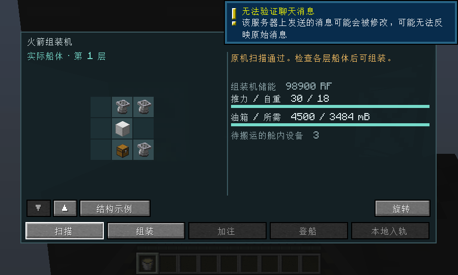

# 从组装机到入轨

Starbridge 0.3 的这段旅程使用高级火箭原模组的组装机、燃料和火箭实体。实测组合是 Forge 1.20.1 / 47.4.28、Retrofit 0.6.2-beta、Advanced Rocketry 1.7.10-1.4.0-32 和 LibVulpes 1.7.10-0.2.8-37。客户端和服务器都需要这组上游内容。要前往 Galacticraft 的月球，还要在两端装好该世界的原始提供方及其前置。船坞测试在固定船舱的星图结束。[原包环境与世界记录](original-runtime.md)

1. **搭发射台。** 铺满一层 3×3 的高级火箭发射台，在一条边的外侧立六格高的结构塔。把组装机放在另一边的外侧，高出平台一格，屏幕朝外。右击组装机，点「结构示例」，使用 ▲、▼ 和「旋转」逐层看。鼠标停在格子上能看到零件名称。
2. **在平台上搭船。** 装上高级火箭的引擎、油箱、导航电脑和座椅，再放一块属于自己的舰桥控制台。首船可直接参考六层结构图。预置样船共 18 个方块，含一个箱子和一个熔炉。给组装机供电，切回「查看实船」，点「扫描」。右侧显示机器读数和需要补上的部件，导航电脑、引擎、油箱或座椅不足时，点「零件位置」会自动翻到示例船里装有该零件的一层，琥珀色框会把零件标出来。按自己的船型装好，回到原组装机重扫。[导航电脑缺失时的实机图](images/shipyard/07-missing-guidance.png)
3. **组装和加注。** 扫描通过后点「组装」。等原机完成，再手持一桶高级火箭推进剂，在火箭附近打开组装机并点「加注」。右侧的「已加注推进剂」显示实际装入的数量。样船用一桶从 0 加到 1,000 mB。
4. **登船并进入本地轨道。** 空出主手，靠近原火箭与组装机，依次点「登船」「本地入轨」。升空后，船长在固定船舱看到星图。航线会显示原目的地是否已安装，以及所需科技、驱动能源和返航储备。需要驱动能源的航段须给舰桥充能。

5. **多人一起起飞。** 给每名乘员装一把原座椅。船长和船员都靠近火箭、空出主手，各自在组装机界面点「登船」。船长看到就座人数后再点「本地入轨」。进入固定船舱后，船员可以起身走动，右击自己的箱子整理货物。[工程师打开船上箱子](images/shipyard/05-engineer-cabin-chest.png) · [取出一颗钻石后](images/shipyard/06-engineer-retrieved-diamond.png)

已经组装的长船可以从船首附近的原组装机加注、登船。要扫描超过原机常规 16 格范围的船，客户端和服务器都需安装旧侧船坞附属，再把高级火箭的监控站放在原组装机正上方。长船也要让推力超过总重，按容量表配足油箱。[安装位置](install-original.md)

[可旋转的结构示例](images/shipyard/01-shipyard-blueprint.png) · [加注后的发射界面](images/shipyard/03-native-launch.png) · [进入船舱时看到的星图](images/shipyard/04-cabin-chart.png) · [实机步骤和证据](shipyard-verification.json)

## 从舰桥前往原月球

登上舰桥后，在星图点选「月球」。点「开启自动驾驶」开始巡航，打开「着陆仪」，在地图上点选落点。接近行星时，「开始降落」按钮亮起。船员可以离开驾驶席，打开船上的箱子和熔炉。

登上露天甲板前准备上游的太空服与氧气。封闭船舱里可以右击供氧器查看储量与密封情况。背包中有氧气罐时，点「装入一罐氧气」就能补充储量。

把地牢所得装进船上的箱子，两人回到甲板后打开舰桥，选「母港」。从着陆仪确认返航靠港，回到原船箱子查看战利品。[船舱供氧面板](images/lunar-cabin-oxygen.png) · [在船上装入原地牢战利品](images/moon-cargo-menu.png) · [双人航程记录和测试预置](original-crew-verification.json)
