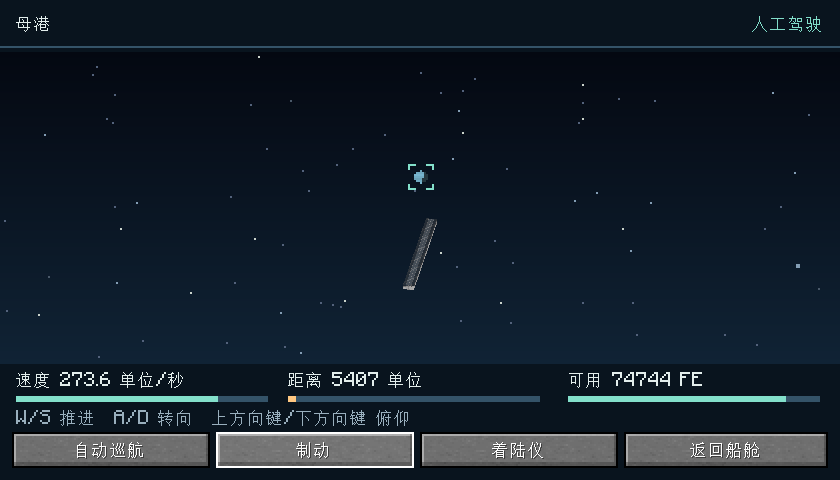

# 双人手动驾驶 300 格宽船

船长从舰桥点选月球并进入第三人称驾驶界面，点「人工接管」。通过界面制动后，船长使用当前绑定的转向、俯仰和推进键，把船对准目标，在大气入口前制动，再从着陆仪确认降落。返程从月球上已配对的终端开始。船员同时走上、下层楼梯，在飞船上打开木桶并用高炉加工粗铜。

这个开发用例用程序操作两个完整生存客户端。船坞专服先用原高级火箭的组装机造好船。航行用新档恢复原船清单，预置装备、能量和母港。星图选择会短暂启动自动巡航。每程从第一次人工接管到进入着陆仪的距离由服务端独立计算。客户端通过界面读导航状态并发送鼠标或绑定按键输入。降落许可、碰撞、收费和机器运行都由游戏处理。

在已有的[宽船测试环境](../wide-fleet/README.md)从仓库根运行。测试专用的四个 JAR 放在独立目录，其中宽船测试附属更换为本次编译的版本。游戏主包和原机清单分别指定。

```powershell
.\gradlew.bat --offline -I qa/manual-wide/fixture.init.gradle reobfManualWideQaJar
$driver = 'qa/manual-wide/.local/build'
$fixtures = 'qa/wide-fleet/.local/fixtures-observe'
$files = 'starbridge-connected-fleet-0.1.0.jar','starbridge-flight-fixture-1.0.0.jar','starbridge-integrated-qa.jar'
foreach ($name in $files) { Copy-Item -LiteralPath (Join-Path $fixtures $name) -Destination $driver }
$gameJar = 'qa/wide-fleet/.local/deck-guard-binary1/starbridge-1.20.1-0.3.0-dev.jar'
py -3 qa/wide-fleet/flight.py 300 manual-study1 qa/wide-fleet/.local/yard-300-a1 $gameJar --fixture-cache $driver
py -3 qa/manual-wide/inspect_manual.py --run qa/wide-fleet/.local/wide-300-manual-study1
py -3 qa/manual-wide/inspect_manual.py --replay qa/manual-wide/evidence/wide-300-manual-study1.zip
```

`wide-300-manual1` 的两程均已独立重放。船长在人工接管后驶过约 6,051 和 6,032 个导航单位，返回了同一份原船和货物。初次转向和俯仰在停稳后完成。见[手动驾驶实测](../../docs/manual-wide-verification.json)。



复测高速改向和复飞时，先在专用测试终端设置 `$env:JAVA_TOOL_OPTIONS="-Dstarbridge.qa.manualBoundary=true"`，然后以包含 `boundary` 的新实例名运行同一组命令。这个选项只由测试附属读取。船长在有推力的状态下同时转向和抬头，制动，重新对准月球。着陆仪确认净空后，船长先点「复飞」，回到大气入口外，再人工调头、接近和降落。封存时使用 `--run <实例> --require-boundary`，独立核对使用 `--replay <ZIP> --require-boundary`。在 `wide-300-manualboundary2`，船长从净空泊位复飞到约 290 个单位外，再手动调头、重新降落并满血返港。这次工程师在低速阶段完成高炉作业，作业期间最高航速为 0.12 单位/刻。

每次试飞使用新的实例名。`manual-pilot.jsonl` 记录按钮、实际键码、机体姿态和收到的导航帧。`manual-server.jsonl` 每四个服务端刻记录是否处于人工控制、船的位置、速度与距目的地的距离。独立复核程序把它们和全船停服存档及工程师的机舱操作对应起来。
