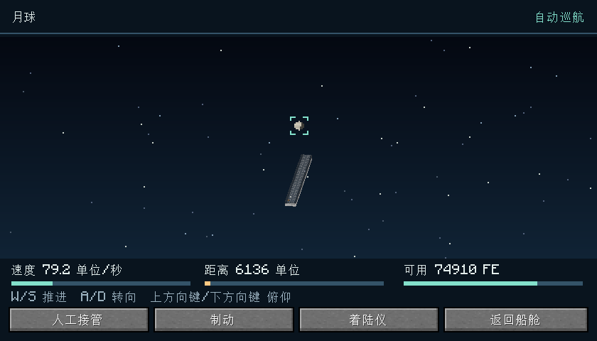
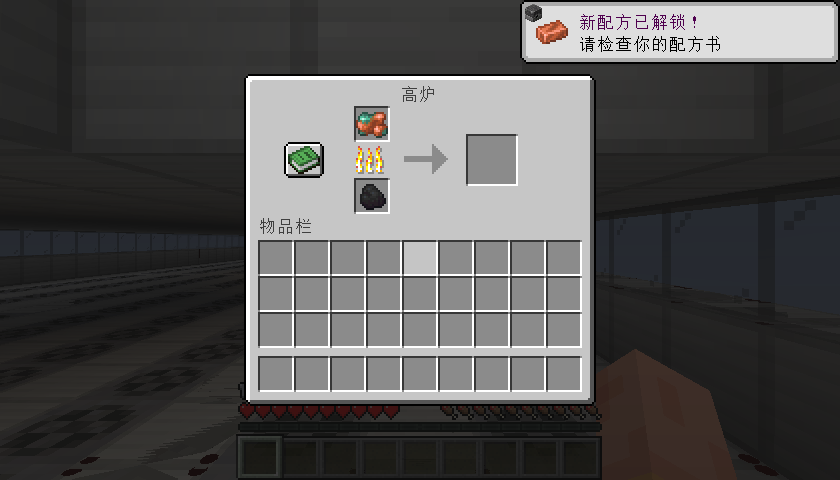

# 双层宽体飞船的两人航行

船长在上层舰桥打开星图，点「月球」和「自动巡航」。第三人称驾驶画面显示这次组装的方块船、目标、速度、距离和剩余电量。工程师在同一时间打开上层木桶，取一块粗铜，走下三格楼梯，把粗铜放进下层高炉。取走铜锭后，工程师走回上层，把成品存进原木桶。船长在着陆仪确认降落，抵达 Galacticraft 月球后，用已配对的终端选母港返航。





三艘船均宽 19 格、高 8 格，分别长 100、200、300 格。每艘有双层甲板、实体楼梯、工作站、储货箱、发动机和油箱。逐档的构建、操作、帧时间、货物、失败和复测都列在[实测记录](../../docs/wide-fleet-verification.json)。

两名角色在三档试飞中均满血返回母港。三个证据包分别复核了 15,200、30,400、45,600 个船体范围内的格子。返航驾驶阶段的帧间隔如下，单位为毫秒。

| 长 × 宽 × 高 | 非空气方块 / 方块实体 | 船长 p50 / p95 / 最大 | 工程师 p50 / p95 / 最大 |
| --- | ---: | ---: | ---: |
| 100 × 19 × 8 | 6,506 / 1,514 | 56.7 / 99.5 / 138.2 | 39.5 / 62.1 / 84.6 |
| 200 × 19 × 8 | 13,014 / 3,022 | 53.1 / 77.7 / 123.9 | 50.8 / 82.3 / 159.2 |
| 300 × 19 × 8 | 19,522 / 4,530 | 48.9 / 93.9 / 111.7 | 38.0 / 50.6 / 63.3 |

100、200 格使用主包 `2dc5d357`。300 格首次返港时，两名角色在等待船体存盘期间从甲板落到 141 格以下的地面。主包 `152eba44` 在这段时间也检查脚下的支撑。第一次候选包试飞还在月面的返航着陆仪就超时，另一趟 `wide-300-a3` 中船长等勘测通过后从图上确认，两人均存活抵港。整次记录里访客最长的单帧在 300 格用例中为 1,435 毫秒。上表只统计返航太空驾驶段。

**实测条件。** 原机发射使用隔离的 Forge 专服，测试程序放置结构并准备机器电力和推进剂，一名模拟驾驶员用原 Advanced Rocketry 组装机扫描、装配、加注并点火。为缩短造同型测试船的时间，原机配置 `buildSpeedMultiplier=0.01`。每次飞行另开一个关闭作弊的生存新档，读入这艘原火箭写出的清单，在舱内准备能量、记住的母港、已配对的终端和两套气密装备。两个完整中文客户端分别担任船长、工程师，访客通过本机 TCP 加入主机发布的局域网。测试附属操作游戏的按键、方块使用和容器槽位，并点击真实界面按钮。工程师返舱存好铜锭后，船长才点着陆仪。手工搜集原料、手动推进与转向、独立服务器上的 10 至 30 名玩家、多日运行各需对应的其他用例。

**从证据包复核。** 在仓库根目录用 Python 3.10 或更高版本运行下列命令。这一步只读已归档的文件，可以在没有 Minecraft 和旧存档的机器上做。结论对应压缩包里的实际主包 SHA-256。

```powershell
$voyages = Get-ChildItem qa/wide-fleet/evidence/wide-*.zip
py -3 qa/wide-fleet/recheck.py @($voyages.FullName)
```

核对程序从原机 NBT 解出每格的方块种类，再以返港舰桥对齐，对照整个船体范围内的非空气和空气格。机器与库存单独核验。它检查两人的落盘维度和生命、月球与母港两人的甲板支撑、两笔各 12,000 FE 的独立收据和清空的交接账本。月球上物理着陆和返回固定船舱时用过不同的 VS 存储区，脚下的实测坐标和两程各自的持久化标记用于定位两处区域。两处区域均要清空。帧间隔直接从船长和访客的原始 CSV 重算。

**在本机重跑。** 准备 JDK 17、Forge 47.4.28 和[全套原模组](../../docs/install-original.md)。`yard.py` 使用已经准备好的 `run-gc-pilot-ci44947273292-crew2/server` 专服和 `run-native-fleet-large300b/server/libraries`。`flight.py` 使用同一全扩展组合的 `OrbitCaptain` 客户端、`run-native-fleet-large300b/FleetCaptain` 的本地启动参数和原生库、给角色配置原装备的测试附属及已有的中文显示设置。测试工具不会下载或重新分发上游模组。新机器可以先按[已有双客户端航程说明](../integrated-fleet/README.md)准备游戏实例。

```powershell
.\gradlew.bat build
.\gradlew.bat -I qa/connected-fleet/fixture.init.gradle -I qa/wide-fleet/fixture.init.gradle reobfConnectedFleetQaJar reobfWideFleetQaJar
py -3 qa/integrated-fleet/build_fixture.py
$shipJar = (Resolve-Path 'build/libs/starbridge-1.20.1-0.3.0-dev.jar').Path
py -3 qa/wide-fleet/yard.py 300 demo1 $shipJar
py -3 qa/wide-fleet/flight.py 300 demo1 qa/wide-fleet/.local/yard-300-demo1 $shipJar
py -3 qa/wide-fleet/verify.py qa/wide-fleet/.local/wide-300-demo1
py -3 qa/wide-fleet/recheck.py qa/wide-fleet/evidence/wide-300-demo1.zip
```

带着陆仪采样的复测会在 `wide-landing-ui.jsonl` 留下服务端发给船长的勘测状态、剩余距离、速度和确认按钮状态。宽体用例给整趟航行留出 4,800 个服务端刻，其他舰队用例沿用原有时限。

每次选择一个新实例名。若已有同一艘船的成功原机清单，`flight.py` 可以直接指向其 `yard-*` 目录。`--fixture-cache` 可以指定一套封存的四个测试附属，两名玩家的游戏主包由单独的 `$shipJar` 参数确定。测试使用不抢占前台的 Windows 桌面，客户端的堆上限分别为 3,840 和 2,304 MiB。每次只运行一组双客户端。
